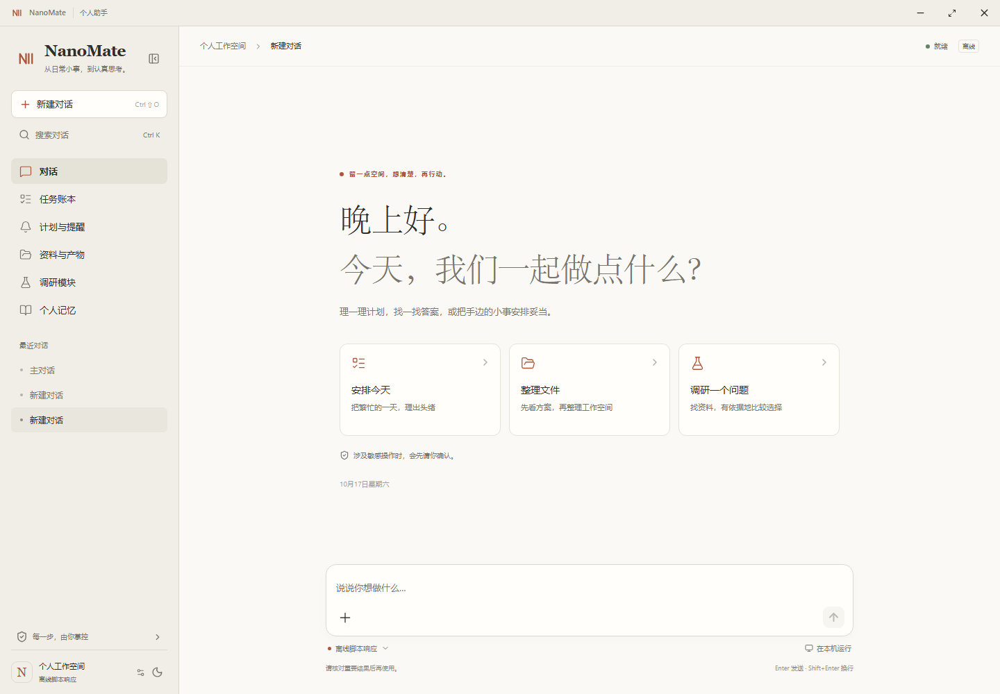
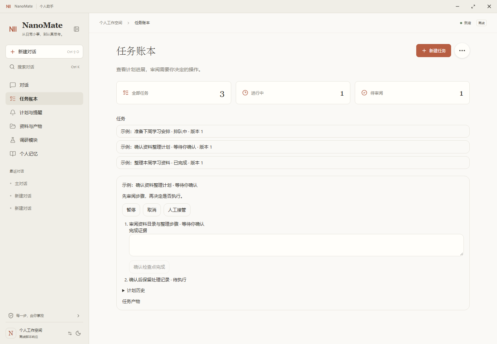
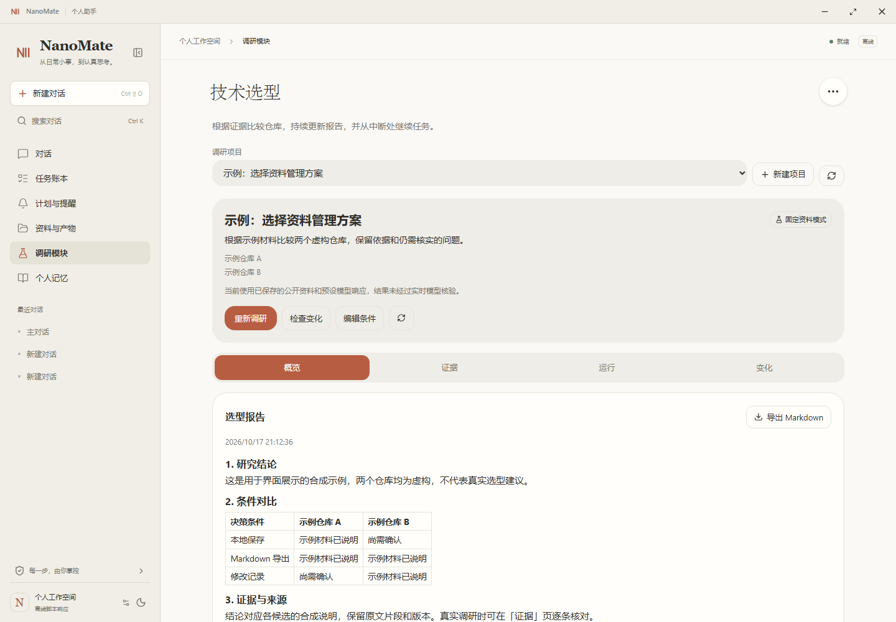

# nanoMuse Assistant

작업 원장과 근거 기반 조사 모듈을 갖춘 Windows 개인 비서.

[English](../../README.md) | [简体中文](../../docs/readme/README_zh.md) | [繁體中文](../../docs/readme/README_zh-TW.md) | [Español](../../docs/readme/README_es.md) | [Français](../../docs/readme/README_fr.md) | [Bahasa Indonesia](../../docs/readme/README_id.md) | [日本語](../../docs/readme/README_ja.md) | [한국어](../../docs/readme/README_ko.md) | [Русский](../../docs/readme/README_ru.md) | [Tiếng Việt](../../docs/readme/README_vi.md)

<p>
  
  
  
  <a href="../../LICENSE"></a>
  <br>
  <a href="https://github.com/chengli200214-beep/continuous-research-assistant/releases/download/desktop-assistant-v1.0.5/nanoMuse-Assistant-1.0.5-win-x64.exe"></a>
  <a href="../../docs/assistant-desktop.md"></a>
  <a href="../../docs/assistant.md"></a>
</p>

**nanoMuse Assistant**는 대화, 계획, 알림, 자료, 조사를 하나로 모읍니다. 목표를 설명하고 단계를 검토한 뒤 영구 저장되는 작업 원장에서 결과를 확인합니다. [nanoMuse](https://github.com/nano-muse/nanoMuse)를 기반으로 독립 Windows 작업 공간을 추가하고 조사 기능을 유지했습니다.

## 제품 화면

별도 오프라인 프로필로 현재 데스크톱 UI 미리보기를 촬영했습니다. 작업, 저장소, 보고서는 합성 예시이며 모델 품질 평가가 아닙니다. 이미지를 열면 원본 크기로 볼 수 있습니다.

<a href="../../docs/images/assistant/desktop-home.png"></a>

<table>
  <tr>
    <td width="50%" valign="top"><a href="../../docs/images/assistant/desktop-tasks.png"></a><br><b>작업 원장과 사용자 확인</b></td>
    <td width="50%" valign="top"><a href="../../docs/images/assistant/desktop-research.png"></a><br><b>조사 조건과 버전별 보고서</b></td>
  </tr>
</table>

## 주요 기능

| 영역 | 기능 |
| --- | --- |
| 대화 | DeepSeek 텍스트 모델, 여러 대화, 제목 검색, 밝은 테마와 어두운 테마. |
| 작업 원장 | 목표, 단계, 계획 버전, 실행 기록과 결과를 재시작 후에도 유지. |
| 계획과 알림 | 알림과 반복 작업을 만들거나 수정하고 변경 사항을 원장에 기록. |
| 자료와 결과물 | 로컬 Markdown을 읽고 출처가 연결된 결과물을 생성하며 내용을 확인. |
| 개인 설정 | 확인한 선호 사항을 저장하고 만료와 삭제를 관리. |
| 제한된 작업 | 파일 작업 미리보기, 브라우저 관찰, 제한된 Windows 작업. 일시 중지와 수동 인계 지원. |
| 조사 | 출처 스냅샷, 근거, 보고서 버전을 보관하고 조건 변경 시 재검토. |
| 승인과 사용량 | 작업별 승인, 불확실한 결과 검토, 공유되는 영구 비용 한도. |

## 시작하기

1. [Windows x64 설치 프로그램, 서명 없음](https://github.com/chengli200214-beep/continuous-research-assistant/releases/download/desktop-assistant-v1.0.5/nanoMuse-Assistant-1.0.5-win-x64.exe)을 내려받아 실행하거나 아래 소스로 빌드합니다. Python과 Chromium이 포함됩니다.
2. 설정이나 모델 선택기에서 **Connections**를 열고 DeepSeek, `https://api.deepseek.com`, `deepseek-flash`를 선택합니다. 키를 로컬 암호화 저장소에 저장합니다.
3. 로컬 `%APPDATA%\nanoMuse Assistant\assistant.toml`의 `[assistant_usage]`에 일일 및 작업별 한도를 지정합니다. 초기값은 0입니다. 검토된 가격 정책과 예약액을 충족하는 한도는 [가이드](../../docs/assistant.md#local-runtime-usage-limits)를 참고하세요. 키는 넣지 않습니다.
4. **Runtime → Use configured model**을 선택하거나 트레이에서 종료 후 `nanoMuse-Assistant.exe --live`로 재시작합니다. 키 저장만으로 모드나 예산 권한이 바뀌지 않습니다.
5. 목표를 말하고 계획과 각 작업을 검토한 뒤 **Task ledger**에서 진행을 확인합니다. 필요하면 중지하거나 직접 제어합니다.

> 새 프로필은 표시된 오프라인 스크립트 응답을 사용합니다. 범용 오프라인 언어 모델이 아닙니다.

## 요청 예시

- 이번 주 학습 목표 세 가지와 회고 목록을 정리해 줘.
- Markdown 노트를 읽고 출처를 포함해 요약해 줘.
- 파일 정리 계획을 먼저 보여주고 내 확인을 기다려 줘.
- 두 저장소를 비교하고 근거와 보고서 버전을 보관해 줘.

## Windows에서 빌드

Windows x64, Git, Node.js 22, Python 3.13, uv가 필요합니다. 루트에서 실행합니다. 스크립트가 JavaScript 의존성, Chromium, Python을 준비합니다.

```powershell
git clone --branch research-assistant https://github.com/chengli200214-beep/continuous-research-assistant.git
cd continuous-research-assistant
uv venv .local/assistant-desktop-build --python 3.13
uv pip sync requirements-assistant-windows.txt --python .local/assistant-desktop-build/Scripts/python.exe --require-hashes --default-index https://pypi.org/simple --no-config
uv pip install --python .local/assistant-desktop-build/Scripts/python.exe --no-deps -e . --default-index https://pypi.org/simple --no-config
uv pip install --python .local/assistant-desktop-build/Scripts/python.exe pyinstaller==6.22.3 --default-index https://pypi.org/simple --no-config
powershell -File scripts/build-assistant-desktop.ps1 -Target installer
```

앱은 `desktop/assistant/dist/win-unpacked/`, 설치 프로그램은 `desktop/assistant/dist/`에 생성됩니다. `-Target dir`는 압축 해제된 앱만 생성합니다. 로컬 설치 프로그램은 서명되지 않았습니다. [가이드](../../docs/assistant-desktop.md)를 참고하세요.

## 데이터와 실행

- Electron이 로컬 Python 서비스를 엽니다. 대화, 작업, 알림, 조사 버전은 로컬 파일과 SQLite에 저장됩니다.
- 필요한 대화와 도구 문맥은 모델 제공자에게 전송됩니다. 로컬 저장이 클라우드 요청까지 컴퓨터에 남는다는 뜻은 아닙니다.
- 창을 닫으면 트레이에서 실행되고 종료하면 전용 서비스가 멈춥니다. 기존 프로필은 `--profile="D:\AssistantData\profile"`로 지정하며 조사 전용 폴더는 자동으로 가져오지 않습니다.

## 현재 범위

- Windows x64 개인 비서에 집중하며 상위 프로젝트의 모바일, relay, Harness 코드를 유지합니다.
- 분리 프로필은 검토된 DeepSeek 텍스트 연결과 결정적 Windows 작업을 지원합니다. 음성 입력, 시각 모델 제어, 임베딩 메모리는 활성화하지 않습니다.
- 알림에는 실행 중인 프로세스와 깨어 있는 컴퓨터가 필요합니다. 새 구조의 절전 및 잠금 화면 복구는 검증 완료로 표시하지 않습니다.

## 문서

- [데스크톱 사용, 빌드, 기존 데이터](../../docs/assistant-desktop.md)
- [계획, 승인, 사용 한도](../../docs/assistant.md)
- [아키텍처](../../docs/architecture.md)
- [상위 프로젝트 및 제삼자 고지](../../THIRD_PARTY_NOTICES.md)

```text
desktop/assistant/   Electron shell
web/src/             React UI
nanomuse/assistant/  Task ledger and action adapters
nanomuse/research/   Evidence and research reports
scripts/desktop-app/ Runtime packaging
```

## 라이선스와 출처

nanoMuse 기반이며 **GPL-3.0-or-later**를 따릅니다. 고지는 [LICENSE](../../LICENSE), [NOTICE](../../NOTICE), [THIRD_PARTY_NOTICES.md](../../THIRD_PARTY_NOTICES.md)에 유지합니다. DeepSeek Harness는 별도 진입점입니다. 규칙은 [CONTRIBUTING.md](../../CONTRIBUTING.md)를 참고하세요.

<details>
<summary>상위 커뮤니티 기여자</summary>

<!-- contributors:start -->
<p>
<a href="https://github.com/wsvn53"></a>
<a href="https://github.com/cutey-none"></a>
<a href="https://github.com/Mola-maker"></a>
<a href="https://github.com/PovedaAqui"></a>
<a href="https://github.com/jiangkaiqi2005"></a>
<a href="https://github.com/Ichiro786"></a>
<a href="https://github.com/hobostay"></a>
<a href="https://github.com/aliabbas6622"></a>
<a href="https://github.com/cypggs"></a>
</p>
<!-- contributors:end -->

</details>
