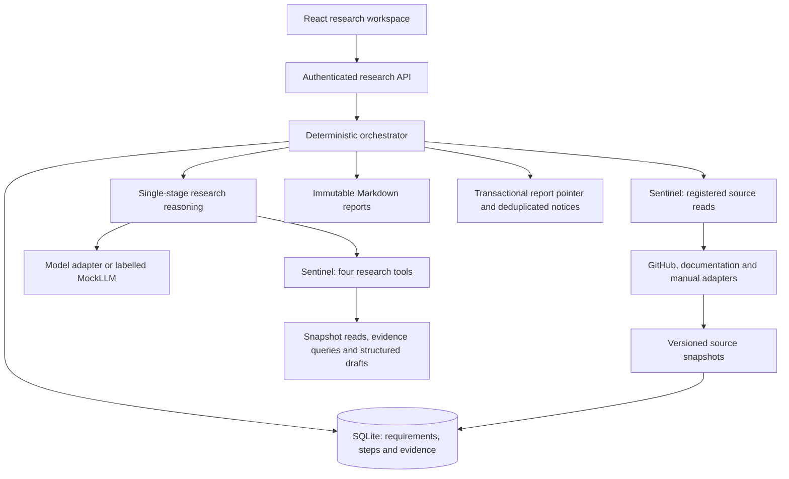
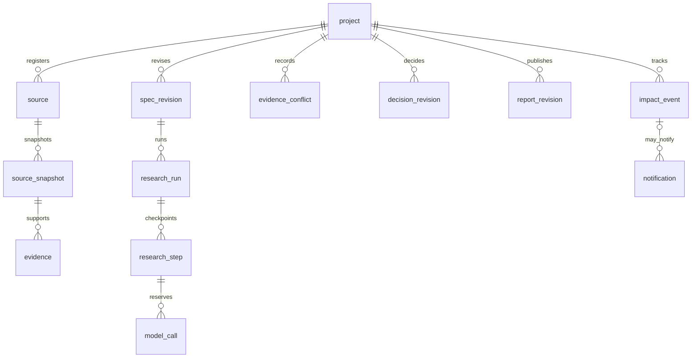
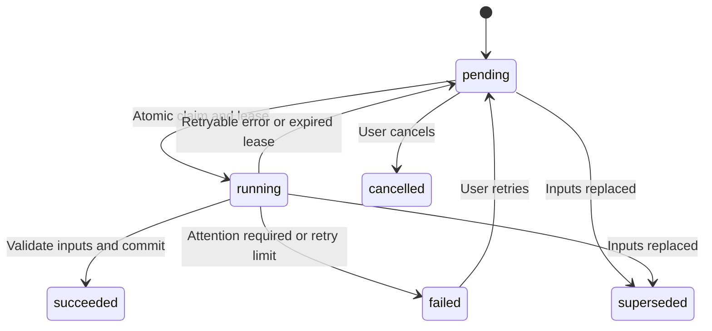

# Continuous technical research: product and demonstration

## Product problem and scope

Repository selection evidence is scattered across READMEs, source files and documentation.
When requirements or versions change, developers need to know which facts still apply and
which decisions need review. A persistent project keeps requirements, evidence and decisions
so a person can explain a choice and identify what to check next.

The first version serves one local user and compares two or three public GitHub repositories.
Its six-section reports distinguish documentation claims, code observations and unknowns.
Tracking checks explicitly registered sources after the user enables it. Multi-tenant hosting,
executing repository code, arbitrary browsing and external messaging are outside this version.
See the [user guide](research.md) for setup and reproduction.

| Decision | Reason and tradeoff |
| --- | --- |
| One research step at a time | Easier to inspect SQLite transactions, leases and recovery; projects queue |
| Registered sources only | Clear source and permission boundaries; missing material requires user input |
| Unknown hard requirements stay unknown | Avoids claiming verification from an inference; recommendations can remain uncertain |
| Immutable reports | A failed publication leaves the previous report readable; history consumes storage |
| Skip the model on unchanged sources | Reduces maintenance work; unregistered changes remain invisible |
| Notify on recommendation impact | Controls noise; semantic filtering still requires live evaluation |

## Implementation and attribution

nanoMuse provides the runtime, model adapters, authentication, Sentinel and React shell. The
extension adds research state, versioned evidence and impact tracking. Open Dots is a design
reference. The fixed upstream revision and GPL-3.0-or-later route are in
[UPSTREAM.md](../UPSTREAM.md). AI coding agents implemented modules; owner review remains
pending. Upstream features and unreviewed generated code must not be presented as independent
handwritten work.

| Module | Engineering problem | Verification |
| --- | --- | --- |
| `store.py`, `orchestrator.py` | Recovery, lease expiry, stale workers and publication | Real subprocess exits, fault matrix and wall-clock probe |
| `context.py`, evidence and requirement versions | Old conclusions after changed inputs | Invalidation, reference binding, correction and reverification tests |
| `reasoning.py`, impact and notification records | Irrelevance, recommendation impact, uncertainty and duplicate reminders | Structured-result and mute tests; live quality remains open |

## Data and states

These are application relationships, not a claim that every edge has a SQL foreign key.
Records retain project ownership. Conflicts bind both evidence references, decisions bind
requirements and evidence, and reports bind decisions. Input changes advance versions and
step commits check that their results still apply.

Runs separately have queued, running, paused, needs_attention, failed, cancelled and succeeded
states. Pausing takes effect after the current step. This diagram simplifies a step lifecycle;
see the [contract](research-contracts.md) for the complete state rules.

## Three-minute demonstration script

Current materials use saved sources and scripted model responses. Keep an offline-replay label
visible and mark accelerated operations. This is a script, not a recorded video.

| Time | Action and explanation | Evidence |
| --- | --- | --- |
| 0:00 to 0:35 | Show Windows requirements, both candidates, a report and one versioned source | Project, report and evidence screens |
| 0:35 to 1:20 | Explain completed steps and recovery logs; a live restart uses confirmed isolated demonstration data and rehearsal | Subprocess recovery and no duplicate report |
| 1:20 to 2:05 | Change a hard requirement, observe the old report become stale, then compare report versions | Requirement revisions, stale marker and report diff |
| 2:05 to 2:40 | Show change/mute controls and zero new calls on unchanged sources; identify semantic reminders as pending live validation | Wall-clock summary and structured-result tests; no fabricated live notice |
| 2:40 to 3:00 | Show 248 research tests, 36 offline workflows, failure cases and the three added modules | Checkpoint, sanitized summary and attribution |

Recording, live-model comparisons and three human trials remain separate deliverables. Saved
history must not be presented as a just-performed action. Scripted responses do not demonstrate
autonomous semantic detection.

## Interview evidence

Explain why continued selection needs versions and recovery, what was reused and added, and
one concrete consistency failure. A worker that lost its lease cannot overwrite new inputs
just because it still has a complete report. Commits must check the attempt, lease, requirement
version and project input version together.

Counts are traceable in the [checkpoint](research-status.md) and
[sanitized follow-up](../evals/research/results/2026-10-15-followup.json). The 248 research
tests and 36 offline workflows are not live-model task counts or accuracy measurements.
Keep the fixture's missed conflicts and meaningful changes visible. Cost, useful-reminder
rates and maintenance improvements require live runs and reviewed scoring. Human recruitment
and trials remain pending.
