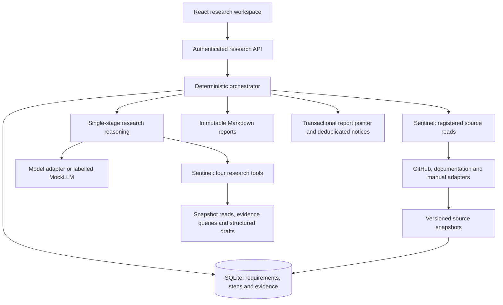
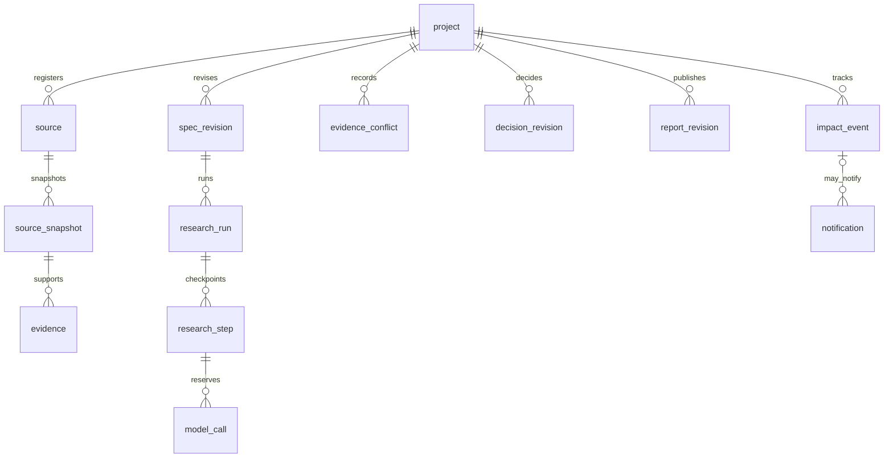
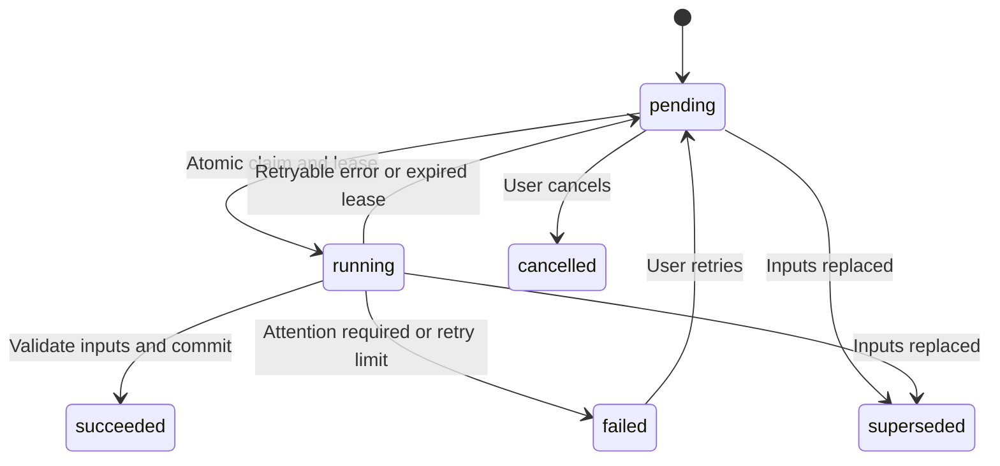

# Continuous technical research: product and demonstration

## Product problem and scope

Repository selection evidence is scattered across READMEs, source files and documentation.
When requirements or versions change, developers need to know which facts still apply and
which decisions need review. A persistent project keeps requirements, evidence and decisions
so a person can explain a choice and identify what to check next.

The first version serves one local user and compares two or three public GitHub repositories.
Its six-section reports distinguish documentation claims, code observations and unknowns.
Tracking checks explicitly registered sources after the user enables it. Multi-tenant hosting,
executing repository code, arbitrary browsing and external messaging are outside this version.
See the [user guide](research.md) for setup and reproduction.

| Decision | Reason and tradeoff |
| --- | --- |
| One research step at a time | Easier to inspect SQLite transactions, leases and recovery; projects queue |
| Registered sources only | Clear source and permission boundaries; missing material requires user input |
| Unknown hard requirements stay unknown | Avoids claiming verification from an inference; recommendations can remain uncertain |
| Immutable reports | A failed publication leaves the previous report readable; history consumes storage |
| Skip the model on unchanged sources | Reduces maintenance work; unregistered changes remain invisible |
| Notify on recommendation impact | Controls noise; semantic filtering still requires live evaluation |

## Implementation and attribution

nanoMuse provides the runtime, model adapters, authentication, Sentinel and React shell. The
extension adds research state, versioned evidence and impact tracking. Open Dots is a design
reference. The fixed upstream revision and GPL-3.0-or-later route are in
[UPSTREAM.md](../UPSTREAM.md). AI coding agents implemented modules; delegated assistant review
does not establish personal authorship. Upstream features and generated code must not be presented as independent
handwritten work.

| Module | Engineering problem | Verification |
| --- | --- | --- |
| `store.py`, `orchestrator.py` | Recovery, lease expiry, stale workers and publication | Real subprocess exits, fault matrix and wall-clock probe |
| `context.py`, evidence and requirement versions | Old conclusions after changed inputs | Invalidation, reference binding, correction and reverification tests |
| `reasoning.py`, impact and notification records | Irrelevance, recommendation impact, uncertainty and duplicate reminders | Structured-result and mute tests; live quality remains open |

## Data and states

These are application relationships, not a claim that every edge has a SQL foreign key.
Records retain project ownership. Conflicts bind both evidence references, decisions bind
requirements and evidence, and reports bind decisions. Input changes advance versions and
step commits check that their results still apply.

Runs separately have queued, running, paused, needs_attention, failed, cancelled and succeeded
states. Pausing takes effect after the current step. This diagram simplifies a step lifecycle;
see the [contract](research-contracts.md) for the complete state rules.

## Project walkthrough and deliverables

Deliver the runnable workspace, Markdown reports, documentation, interface screenshots and
reproducible acceptance records. Video, presentation slides and screen recordings were removed
from the delivery scope at the owner's request. The generated video and its dedicated
generation materials were removed; six interface screenshots remain under
`.local/showcase/screenshots/`, with reviewed copies under `docs/screenshots/research/`.

The screenshots below show the offline fixture workspace captured on 2026-10-15. They
contain public repository text and synthetic project/run IDs, with no keys, private paths
or personal contact details visible. They document that historical UI, not the later live
model results or the exact current wording.

[Evidence](screenshots/research/02-evidence.jpg), [runs](screenshots/research/03-runs.jpg),
[tracking](screenshots/research/04-changes.jpg), [conditions](screenshots/research/05-conditions.jpg)
and [report differences](screenshots/research/06-report-diff.jpg).

Use the following order to inspect the project. Identify saved history, fixture inputs and
scripted model responses when showing them.

| Step | Action and explanation | Evidence |
| --- | --- | --- |
| 1 | Show Windows requirements, both candidates, a report and one versioned source | Project, report and evidence screens |
| 2 | Inspect completed steps and recovery logs; use isolated data when reproducing a process restart | Subprocess recovery and no duplicate report |
| 3 | Change a hard requirement, observe the old report become stale, then compare report versions | Requirement revisions, stale marker and report diff |
| 4 | Inspect change/mute controls and zero new calls on unchanged sources; identify semantic reminders as pending live validation | Wall-clock summary and structured-result tests; no fabricated live notice |
| 5 | Inspect the research tests, earlier 36 offline workflows, live acceptance, failure cases and added modules | Checkpoint, sanitized summary and attribution |

The live two-repository comparison and process recovery are recorded in the
[checkpoint](research-status.md). The owner waived the three human trials.
Saved history must not be presented as a just-performed action. Scripted responses do not
demonstrate autonomous semantic detection.

## AI-assisted implementation and owner review

The implementation separates source acquisition (`sources/`), reasoning and validation
(`reasoning.py`, `context.py`), durable state and orchestration (`store.py`, `orchestrator.py`),
and the web workspace. Shared types live in `contracts.py`; routes and report rendering use
those types. Source acquisition returns data only, the reasoner proposes structured drafts,
and the store validates and publishes within fenced transactions.

The review repair was carried out sequentially by the coding assistant. Earlier generated
implementation and evaluations remain subject to the owner's review. Automated checks cover
contracts, leases, source restrictions and reproducible usage; they do not establish that
the owner has read the code or that every model claim is correct.

Before presenting personal engineering ownership, the owner should review `store.py`,
`orchestrator.py` and `context.py`, explain a stale-worker failure and its regression test,
trace one recommendation to its evidence, and record which design choices they accepted
or changed. The owner delegated the remaining review to the assistant and waived the three
human trials. The checkpoint reports assistant findings without claiming owner authorship
or independent human validation.

## Interview evidence

Explain why continued selection needs versions and recovery, what was reused and added, and
one concrete consistency failure. A worker that lost its lease cannot overwrite new inputs
just because it still has a complete report. Commits must check the attempt, lease, requirement
version and project input version together.

Counts are traceable in the [checkpoint](research-status.md) and
[sanitized live summary](../evals/research/results/2026-10-15-live.json). Research test
counts and earlier 36 offline workflows are not live-model task counts or accuracy measurements.
Keep the fixture's missed conflicts and meaningful changes visible. Cost, useful-reminder
rates and maintenance improvements require live runs and reviewed scoring. Human recruitment
and trials were waived by the owner, not completed.
