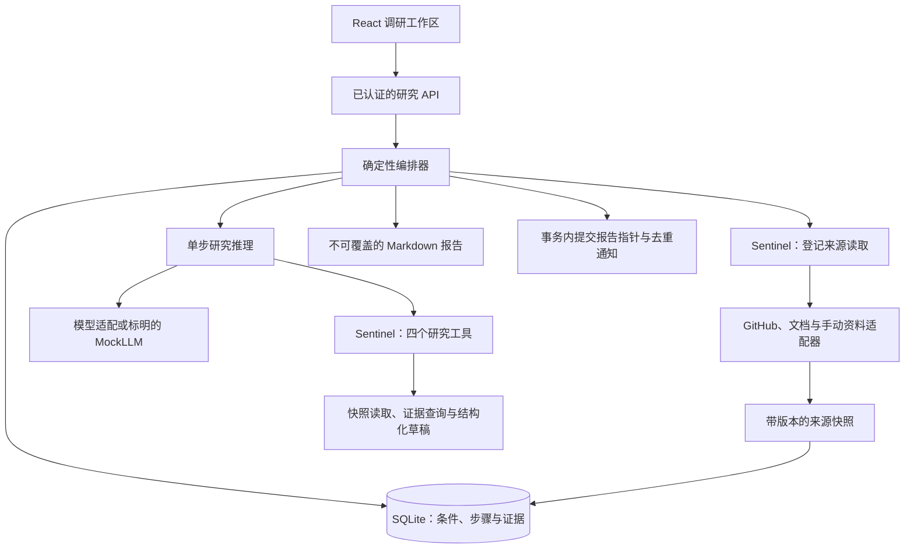
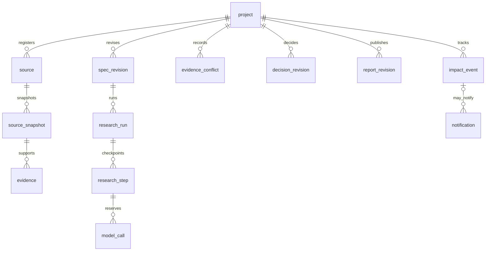
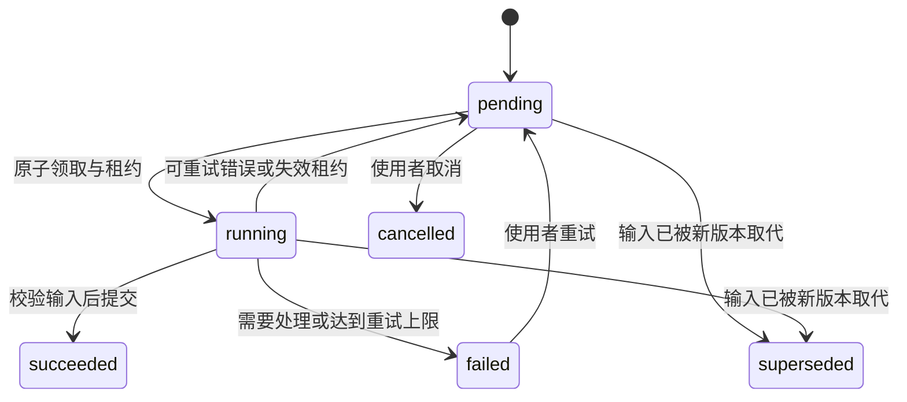

# 持续技术选型助手：产品与展示说明

## 产品问题与范围

开发者比较开源仓库时，依据通常分散在 README、源码和官方文档里。项目要求或仓库版本
发生变化后，需要重新判断哪些事实仍然成立、哪些结论应该重查。产品围绕一个持续维护的
选型项目保存条件、证据和决策，帮助使用者回答「为什么这样选」和「现在需要重查什么」。

第一版面向一个本地用户，每个项目比较两个或三个公开 GitHub 仓库。输出六部分报告，
保留来源版本、文档声明与源码观察的区别，以及无法确认的条件。用户主动开启跟踪后，
检查已登记来源并记录影响。多租户、自动执行仓库代码、任意网页探索和外部消息推送不在
第一版范围。启动与复现见[使用说明](research.md)。

| 产品决定 | 原因与代价 |
| --- | --- |
| 一个研究步骤同时执行 | SQLite 事务、租约和恢复更容易检查；处理多个项目时需要排队 |
| 只读已登记来源 | 来源与权限边界清楚；资料不足时需要使用者补充 |
| 硬条件缺依据时保持无法确认 | 避免把文档推断当成验证；推荐可能暂时不确定 |
| 不覆盖报告版本 | 新结果提交失败时旧报告仍可读；需要保留历史文件 |
| 无来源变化时跳过模型 | 控制持续检查成本；来源未登记的变化不会被发现 |
| 重要影响才生成变化提醒 | 减少噪声；语义判断仍须真实模型和人工评价 |

## 实现与上游归属

nanoMuse 提供 Python 运行时、模型适配、认证、Sentinel 和 React 外壳。本项目新增研究
状态、版本证据和影响提醒，Open Dots 仅作设计参考。固定版本与 GPL-3.0-or-later 路线见
[UPSTREAM.md](../../UPSTREAM.md)。AI 编码代理参与模块实现，所有者的逐项审查仍待完成，
不能将上游能力或尚未审查的生成代码写成独立手写成果。

| 核心模块 | 工程问题 | 核验入口 |
| --- | --- | --- |
| `store.py`、`orchestrator.py` | 重启恢复、租约到期、旧 worker 提交与原子发布 | 实际进程退出测试、故障矩阵、真实时间检查 |
| `context.py`、证据与条件版本 | 修改条件或资料后，旧结论不能当作新结论使用 | 版本失效、引用绑定、纠正与重新核验测试 |
| `reasoning.py`、影响与通知表 | 区分无关变化、推荐影响和信息不足，控制重复提醒 | 结构化影响测试、去重与静默测试；真实效果待验收 |

## 数据与状态

该图表示应用层关联，全部记录带项目归属，并非每条关系都由数据库外键表达。
证据冲突保存双方证据引用；决策引用条件和证据；报告保存决策引用。条件、来源快照与
报告按版本保存，输入变化递增版本，步骤提交核对其仍适用于当前项目。

运行层另有 queued、running、paused、needs_attention、failed、cancelled、succeeded。
暂停在当前步骤完成后的边界生效。上图简化展示单步生命周期，完整接口和状态约束见
[契约](research-contracts.md)。

## 三分钟讲解视频与演示脚本

已生成 180 秒、1920×1080 的本地截图讲解视频，包含中文配音、24 条字幕和六个界面章节。
素材是实际工作台截图，全程标明「离线回放 · 截图讲解」，没有把静态截图合成说成连续
操作录屏。文件在 `.local/showcase/research-walkthrough-final.mp4`，字幕为同目录的
`research-walkthrough-final.srt`，六张原图与本地生成脚本也保留在该目录。视频已做完整
音视频解码、时长与关键帧检查。

下表是连续操作版本的镜头脚本，仍待实际录制。当前固定资料与脚本模型不能替代真实模型
验收；加速操作还须标明「加速」。

| 时间 | 实际操作与讲述 | 所需证据 |
| --- | --- | --- |
| 0:00 至 0:35 | 打开现有项目，展示 Windows 条件、两个候选和六部分报告；打开一条证据的版本出处 | 项目、报告与证据页 |
| 0:35 至 1:20 | 展示运行的已完成步骤与恢复日志；若现场终止研究服务，先确认演示数据目录，再重启；录制需预先预留时间 | 独立进程退出记录、恢复位置和无重复报告 |
| 1:20 至 2:05 | 修改一个必须满足的条件，观察旧报告过期，等待离线流程生成新版本，再打开报告差异 | 条件版本、过期状态、两个报告版本 |
| 2:05 至 2:40 | 展示变化与静默入口、无变化复查的零新增调用。说明重要更新与冲突的语义判断尚待真实模型验证 | 真实时间检查摘要、结构化提醒测试；不伪造实时提醒 |
| 2:40 至 3:00 | 展示 248 项研究测试、36 次离线流程与公开失败案例，解释三个新增模块和复用范围 | 开发记录、脱敏摘要与上游说明 |

连续操作录屏、真实模型对比和三人试用仍是独立交付项。现场演示不应把测试预设响应讲成模型
自主识别的结果，或将已保存的历史记录讲成刚刚发生的操作。

## 面试讲述与证据边界

先说明持续选型为何需要版本和恢复，再说明复用了什么、补充了什么，随后用一个具体失败
解释设计取舍。例如旧 worker 已失去租约时，不能因为手中仍有完整报告就覆盖新的输入。
提交必须同时检查执行 attempt、租约、条件版本和项目输入版本。

可核验的数字见[开发记录](research-status.md)与[脱敏结果](../../evals/research/results/2026-10-15-followup.json)。
248 项研究测试和 36 次离线工作流不能改写成 248 个真实模型任务或研究准确率。
固定脚本未识别的冲突与重要变化须保留为失败边界。没有真实评测与人工判分前，费用、
提醒有效率和维护成本改善不填写百分比。真人试用尚未进行，招募与复测记录保留待办。
