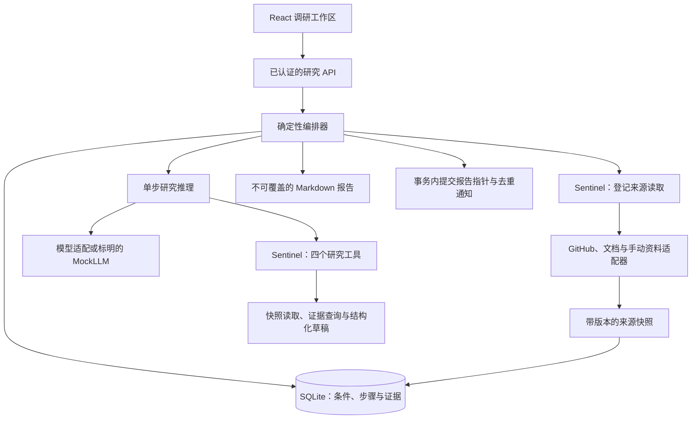
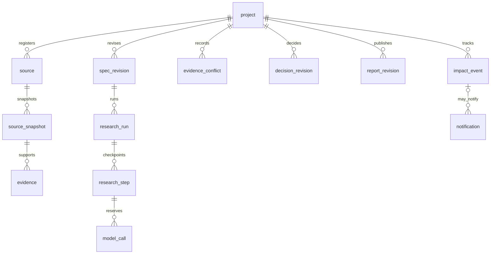
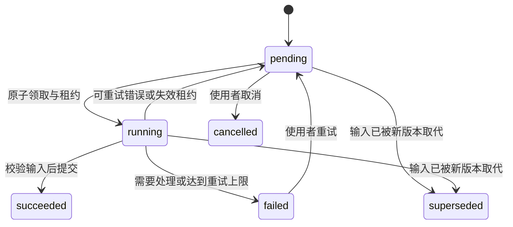
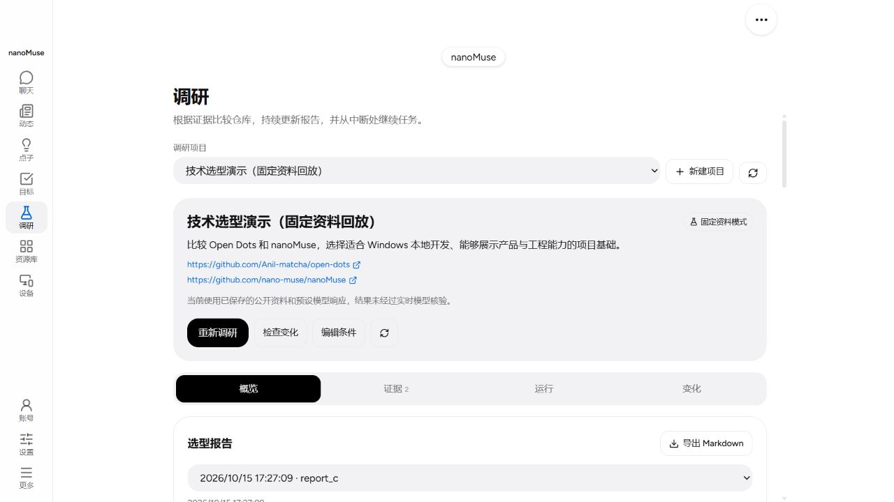

# 持续技术选型助手：产品与展示说明

## 产品问题与范围

开发者比较开源仓库时，依据通常分散在 README、源码和官方文档里。项目要求或仓库版本
发生变化后，需要重新判断哪些事实仍然成立、哪些结论应该重查。产品围绕一个持续维护的
选型项目保存条件、证据和决策，帮助使用者回答「为什么这样选」和「现在需要重查什么」。

第一版面向一个本地用户，每个项目比较两个或三个公开 GitHub 仓库。输出六部分报告，
保留来源版本、文档声明与源码观察的区别，以及无法确认的条件。用户主动开启跟踪后，
检查已登记来源并记录影响。多租户、自动执行仓库代码、任意网页探索和外部消息推送不在
第一版范围。启动与复现见[使用说明](research.md)。

| 产品决定 | 原因与代价 |
| --- | --- |
| 一个研究步骤同时执行 | SQLite 事务、租约和恢复更容易检查；处理多个项目时需要排队 |
| 只读已登记来源 | 来源与权限边界清楚；资料不足时需要使用者补充 |
| 硬条件缺依据时保持无法确认 | 避免把文档推断当成验证；推荐可能暂时不确定 |
| 不覆盖报告版本 | 新结果提交失败时旧报告仍可读；需要保留历史文件 |
| 无来源变化时跳过模型 | 控制持续检查成本；来源未登记的变化不会被发现 |
| 重要影响才生成变化提醒 | 减少噪声；语义判断仍须真实模型和人工评价 |

## 实现与上游归属

nanoMuse 提供 Python 运行时、模型适配、认证、Sentinel 和 React 外壳。本项目新增研究
状态、版本证据和影响提醒，Open Dots 仅作设计参考。固定版本与 GPL-3.0-or-later 路线见
[UPSTREAM.md](../../UPSTREAM.md)。AI 编码代理参与模块实现，受托助手审阅不证明本人的实现贡献，
不能将上游能力或尚未审查的生成代码写成独立手写成果。

| 核心模块 | 工程问题 | 核验入口 |
| --- | --- | --- |
| `store.py`、`orchestrator.py` | 重启恢复、租约到期、旧 worker 提交与原子发布 | 实际进程退出测试、故障矩阵、真实时间检查 |
| `context.py`、证据与条件版本 | 修改条件或资料后，旧结论不能当作新结论使用 | 版本失效、引用绑定、纠正与重新核验测试 |
| `reasoning.py`、影响与通知表 | 区分无关变化、推荐影响和信息不足，控制重复提醒 | 结构化影响测试、去重与静默测试；真实效果待验收 |

## 数据与状态

该图表示应用层关联，全部记录带项目归属，并非每条关系都由数据库外键表达。
证据冲突保存双方证据引用；决策引用条件和证据；报告保存决策引用。条件、来源快照与
报告按版本保存，输入变化递增版本，步骤提交核对其仍适用于当前项目。

运行层另有 queued、running、paused、needs_attention、failed、cancelled、succeeded。
暂停在当前步骤完成后的边界生效。上图简化展示单步生命周期，完整接口和状态约束见
[契约](research-contracts.md)。

## 项目查看顺序与交付物

交付可运行工作台、Markdown 报告、项目文档、界面截图和可复现的验收记录。按所有者要求，
视频、PPT 与录屏已移出交付范围，生成的视频及专用生成素材已删除。六张界面截图保留在
`.local/showcase/screenshots/`，检查后的副本位于 `docs/screenshots/research/`。

以下截图记录 2026-10-15 的离线固定资料工作台，显示公开仓库文本与合成项目、运行 ID，
没有可见密钥、私有路径或个人联系方式。截图说明当时界面，不代表后续真实模型结果或
当前版本的全部文案。

[证据](../screenshots/research/02-evidence.jpg)、[运行](../screenshots/research/03-runs.jpg)、
[跟踪](../screenshots/research/04-changes.jpg)、[条件](../screenshots/research/05-conditions.jpg)
与[报告差异](../screenshots/research/06-report-diff.jpg)。

可按下表查看项目。展示保存的历史记录、固定资料或脚本模型响应时，应明确说明其来源。

| 顺序 | 实际操作与讲述 | 所需证据 |
| --- | --- | --- |
| 1 | 打开现有项目，展示 Windows 条件、两个候选和六部分报告；打开一条证据的版本出处 | 项目、报告与证据页 |
| 2 | 查看已完成步骤与恢复日志；复现服务终止与重启时使用独立数据目录 | 独立进程退出记录、恢复位置和无重复报告 |
| 3 | 修改一个必须满足的条件，观察旧报告过期，等待离线流程生成新版本，再打开报告差异 | 条件版本、过期状态、两个报告版本 |
| 4 | 查看变化与静默入口、无变化复查的零新增调用。说明重要更新与冲突的语义判断尚待真实模型验证 | 真实时间检查摘要、结构化提醒测试；不伪造实时提醒 |
| 5 | 查看研究测试、此前 36 次离线流程、真实验收与公开失败案例，解释新增模块和复用范围 | 开发记录、脱敏摘要与上游说明 |

真实两仓库比较和进程恢复已记入[开发记录](research-status.md)，三人试用已由用户取消。
现场演示不应把测试预设响应讲成模型自主识别的结果，或将已保存的历史记录讲成
刚刚发生的操作。

## AI 辅助实现与本人审查 {#ai-assisted-implementation-and-owner-review}

实现分为来源获取（`sources/`）、推理与校验（`reasoning.py`、`context.py`）、持久状态与编排
（`store.py`、`orchestrator.py`）、网页工作台。共享类型集中在 `contracts.py`，接口和报告
渲染沿用这些类型。来源获取只返回数据，推理器只提出结构化草稿，存储层在带提交围栏的
事务内校验并发布。

本轮审查修复由编程助手顺序执行。此前生成的实现与评测仍需所有者审查。自动检查覆盖
契约、租约、来源权限和可复算用量，不能代替本人阅读代码或确认全部模型主张。

对外说明个人工程贡献前，所有者应审查 `store.py`、`orchestrator.py`、`context.py`，解释一
个旧 worker 提交失败的案例及回归用例，追溯一项推荐的证据，并记录本人接受或修改的设计
取舍。用户已委托助手完成剩余审阅，并取消三人试用。开发记录记载助手审阅结论，不把它
当作本人的实现贡献或独立人工验证。

## 面试讲述与证据边界

先说明持续选型为何需要版本和恢复，再说明复用了什么、补充了什么，随后用一个具体失败
解释设计取舍。例如旧 worker 已失去租约时，不能因为手中仍有完整报告就覆盖新的输入。
提交必须同时检查执行 attempt、租约、条件版本和项目输入版本。

可核验的数字见[开发记录](research-status.md)与[真实验收摘要](../../evals/research/results/2026-10-15-live.json)。
研究测试数量和此前 36 次离线工作流不能改写成真实模型任务数或研究准确率。
固定脚本未识别的冲突与重要变化须保留为失败边界。没有真实评测与人工判分前，费用、
提醒有效率和维护成本改善不填写百分比。用户已取消真人试用与招募要求，不计作完成试用。
